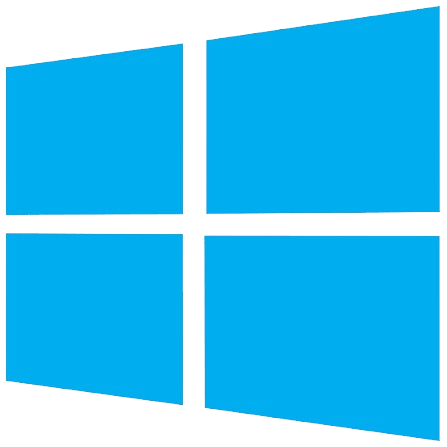
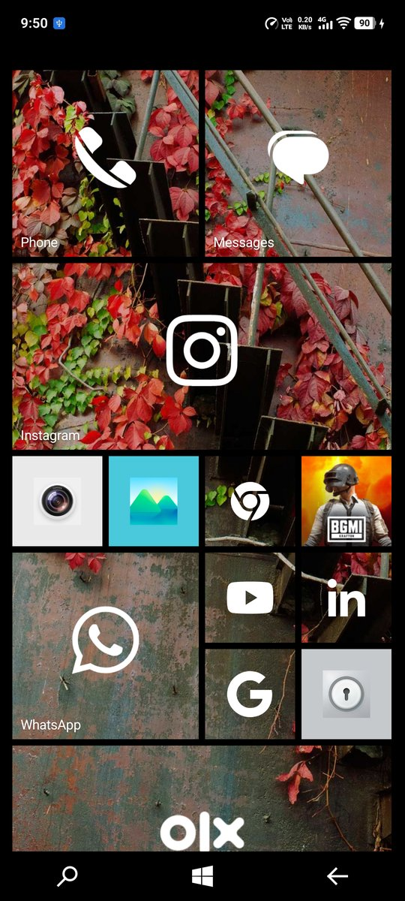
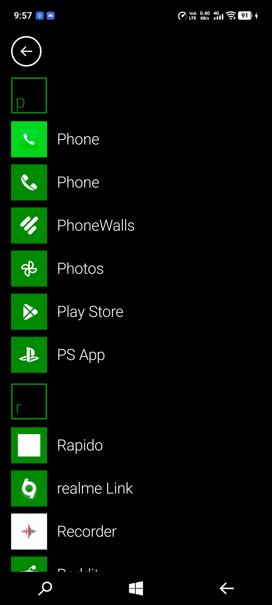
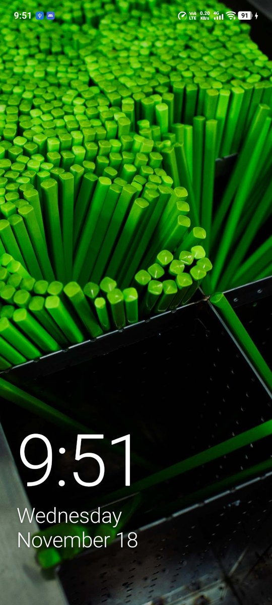
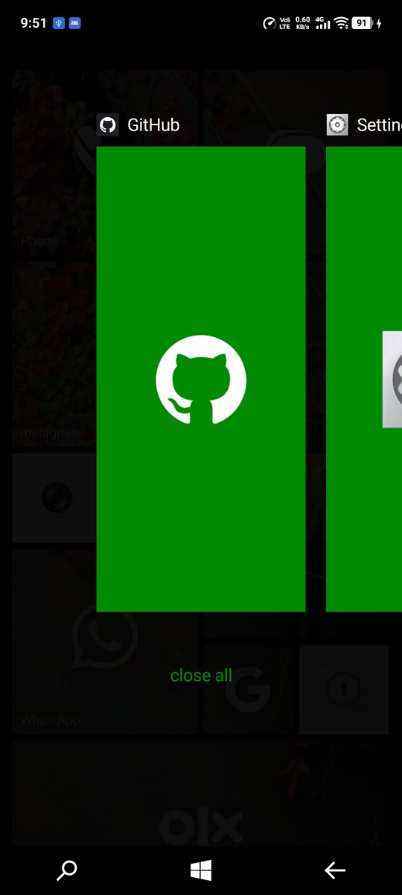
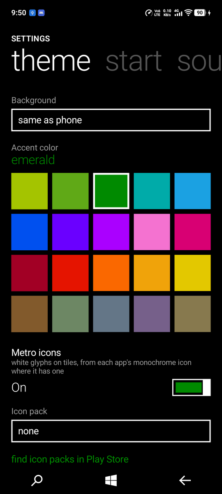
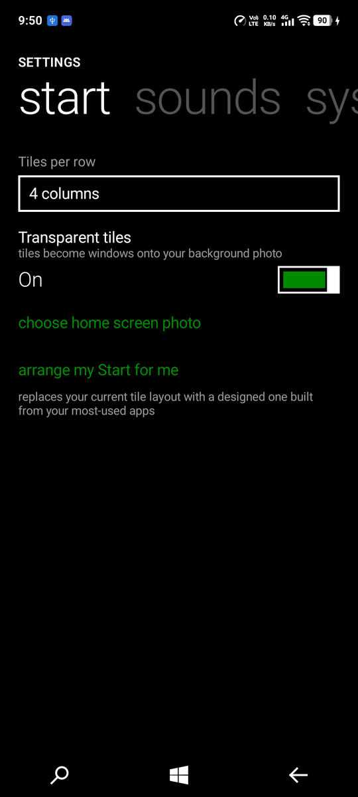

<div align="center">

#  Metro Launcher

**A Windows Phone 8 style home screen for Android, written in Kotlin and Jetpack Compose.**

Live tiles that tilt and flip, turnstile page transitions, a curtain lock screen with real physics,
the WP8.1 volume panel, and the search / start / back bar on every screen.


<a href="https://github.com/soumya007GitHub/Windows-Launcher/releases/latest/download/MetroLauncher.apk"></a>

</div>

---

## Screenshots

<table>
  <tr>
    <td align="center"><br/><sub><b>Start</b>: transparent tiles</sub></td>
    <td align="center"><br/><sub><b>All apps</b>: letter groups</sub></td>
    <td align="center"><br/><sub><b>Lock screen</b>: curtain</sub></td>
  </tr>
  <tr>
    <td align="center"><br/><sub><b>Recents</b>: hold Back</sub></td>
    <td align="center"><br/><sub><b>Settings</b>: theme pivot</sub></td>
    <td align="center"><br/><sub><b>Settings</b>: start pivot</sub></td>
  </tr>
</table>

## Features

### Start screen
- **Live tiles** in small (1×1), medium (2×2) and wide (4×2) sizes on a 4- or 6-column grid.
- **Tile tilt**: tiles press in toward the point you touch, like on Windows Phone.
- **Live tile flip**: tiles show notification counts and previews and flip between faces.
- **Edit mode**: long-press a tile to drag it, resize it, unpin it or change its icon.
- **Transparent tiles** (on by default): each tile shows its part of the wallpaper, so the whole Start screen looks like one picture.
- **26 built-in wallpapers**: a random one is applied on first install. Pick another from the gallery in settings, or use any photo from your phone.
- **Arrange my Start**: builds a tidy layout from the apps you use most.
- **Icons**: white Metro glyphs taken from each app's monochrome icon, full-size artwork for apps without one, any installed icon pack, or a custom image for each tile.

### Navigation
- **Turnstile transitions** between Start, the app list and settings.
- **All apps** is one swipe to the right, with letter groups and a context menu that flips in.
- **Search / Start / Back bar** on every screen, including inside other apps (uses the accessibility service).
- **Recents**: hold Back to see your recent apps as cards, in the same order as Android's own Recents. Swipe a card up to close it, or tap **close all**.
- **Instant lock tile**: pin the phone's one-tap lock app and tapping it turns the screen off immediately.

### Lock screen
- **Curtain lock screen**: pull it up to unlock. It follows your finger, falls back with gravity and bounces.
- **Separate lock screen photo**: one of the built-in wallpapers, any photo from your phone, or the same photo as the Start screen.
- **Metro notification icons**: each app with notifications shows its white glyph and a count.
- **Lock and unlock sounds**: the Windows Phone lock and unlock sounds play every time the phone locks and unlocks while it's in ring mode (or use your own audio files). They have their own volume (low / medium / high / max in Settings → sounds), so media, ringer and notification volume don't affect them, and they're loaded in advance so they play instantly.
- **Swipe-up gate**: on a phone with no PIN, nothing can be used until the curtain is lifted.
- **Status bar and navigation bar on the lock screen**: the WP status bar sits transparently over the photo (no notification icons), and tapping Start on the bar lifts the curtain.

### Action Center and status bar
- **Windows Phone 8.1 Action Center**: swipe down from the top edge. A short pull shows the quick actions; a longer pull shows your notifications, grouped by app, with **clear all**.
- **Quick actions**: four wide tiles with Metro icons and live labels (your Wi-Fi network, Bluetooth device or carrier). **Expand** shows every other tile. Choose the four from the same tiles your phone's own quick settings offer.
- **Brightness slider** with an **auto** switch.
- **Windows Phone status bar** in every app: signal, Wi-Fi, Bluetooth, quiet hours, white notification icons, battery and time.

### Keyboard
- **Metro keyboard**: a Windows Phone style keyboard with flat keys that light up in your accent colour.
- Letters with auto-capitals and caps lock, two pages of symbols, and **emoji** in 8 categories plus recently used.
- The Enter key changes to *go*, *search*, *send*, *next* or *done* to suit the text field; hold space to switch keyboards.

### System
- **WP8.1 volume panel**: Ringer, Notifications and Media sliders, silent-mode toggle and a link to sound settings.
- **Themes**: dark, light or *same as phone*, with 20 Windows Phone accent colours.
- **Pivot settings**: theme, start, sounds, notifications, system and about pages, with list pickers.
- **On/off switches** for the Metro home screen, keyboard, Metro bar and volume panel. Switching the home screen off returns you to Android's launcher and turns Metro's features off; switching it on brings them back.
- **Updates**: *Settings → about → check for updates* finds the newest release on GitHub, downloads it and installs it, with the Windows Phone loading dots while it works.
- Launcher screens stay in **portrait**, even with auto-rotate on.
- **Android app-switch animations** switch: turn off Android's open / close / switch animation so apps appear instantly.

## Requirements

| | Minimum | Recommended |
|---|---|---|
| **Android version** | Android 8.0 Oreo (API 26) | Android 10 or newer |
| **Screen** | Phone, about 4.5" / 360 dp wide (720p) | 6"+ phone, 1080p |
| **Orientation** | Portrait (built for portrait phones) | Portrait |
| **RAM** | 2 GB | 4 GB+ for smooth transparent tiles |
| **Build tools** | JDK 17, Android SDK 36 | Android Studio (latest stable) |

Layouts use density-independent units and tile sizes are worked out from the screen width, so the
launcher fits most phone screens. Tablets and foldables work, but the layout is designed for
portrait phones.

### Permissions

All of these are optional and can be granted from **Settings → system** inside the launcher.

| Permission | Used for |
|---|---|
| Default home app | Opening Metro when you press Home |
| Notification access | Live tile counts and previews, and lock screen counts |
| Usage access | The recent apps switcher |
| Display over other apps | The curtain lock screen |
| Accessibility service ("Metro") | The nav bar inside other apps, and the volume panel |
| Metro keyboard *(optional)* | Typing with the Windows Phone style keyboard |
| Internet and *install unknown apps* | Checking for, downloading and installing updates from GitHub |
| Modify system settings *(optional)* | Brightness slider, auto brightness and rotation lock in the Action Center |
| View network connections | Showing whether Wi-Fi is connected on the Action Center tile |
| Location and nearby devices *(optional)* | Showing your Wi-Fi network and Bluetooth device names on the Action Center tiles |
| `WRITE_SECURE_SETTINGS` *(adb, optional)* | Turning the accessibility service back on if the system switches it off, and the one-tap on/off switches |

> **Note for Vivo / OriginOS, MIUI, ColorOS and similar systems:** these systems often switch off
> accessibility services and stop background apps. Allow Metro to run in the background, and
> optionally grant the permission below so the launcher can turn its service back on:
>
> ```bash
> adb shell pm grant dev.metro.launcher android.permission.WRITE_SECURE_SETTINGS
> ```

## Download

Get the latest **[MetroLauncher.apk](https://github.com/soumya007GitHub/Windows-Launcher/releases/latest/download/MetroLauncher.apk)** from the [Releases](https://github.com/soumya007GitHub/Windows-Launcher/releases) page. Open it on your phone, allow *install unknown apps* when asked, then press **Home** and choose **Metro**.

From version 1.2.0, Metro can update itself: open **Settings → about** and tap **check for updates**.

### First-run setup

The first time Metro opens, it shows a Windows logo while it gets ready, then walks you through each
permission on its own Windows Phone style screen, with **skip** and **permit**: home screen, the Metro
service (status bar, navigation bar, Action Center, volume panel), notifications, lock screen, recent
apps, brightness, quiet hours and network names. Anything already allowed is skipped, and nothing is
switched on without your OK. On Android 13 and newer, the Metro service screen also explains how to
unlock "restricted settings" for apps installed outside the Play Store.

## Build and install

```bash
git clone https://github.com/soumya007GitHub/Windows-Launcher.git
cd Windows-Launcher

# Release build (smooth scrolling; signed with your local debug key for personal use)
./gradlew :app:assembleRelease          # Windows: .\gradlew.bat :app:assembleRelease

adb install -r app/build/outputs/apk/release/app-release.apk
```

Then press **Home** and choose **Metro** as the default home app, or open **Settings → system** in
the launcher and tap *make Metro your home screen*.

> Use the **release** build for daily use. Debug builds of Compose apps are much slower when scrolling.
> Before publishing an APK, set up your own release signing key in `app/build.gradle.kts`.

## Project structure

```
app/src/main/java/dev/metro/launcher/
├── physics/        Tilt, turnstile, spring and live tile flip (Modifier.Node based)
├── start/          Start grid, tile faces, edit mode, icon picker, "arrange my Start"
├── allapps/        App list with letter groups and the animated context menu
├── lock/           Curtain lock screen, lock service, swipe-up gate
├── recents/        Recent apps switcher (Android's order of opened apps, via usage access)
├── volume/         Accessibility service, WP8.1 volume panel, service keeper
├── nav/            Search / Start / Back bar (inside the launcher and over other apps)
├── notifications/  NotificationListenerService that feeds the live tiles
├── settings/       Pivot settings pages and the update section
├── keyboard/       Metro keyboard (input method service, letters, symbols, emoji)
├── actioncenter/   WP 8.1 Action Center, quick actions and the WP status bar
├── update/         Update check, download and install from GitHub Releases
├── wallpapers/     Built-in wallpapers and the gallery strip
├── home/           Home role, on/off switches
├── sound/          Lock / unlock sounds (decoded once, played instantly)
├── apps/           App list, Metro glyphs, icon artwork, icon packs

├── data/           Saved settings, tile layout and photos
└── ui/             Theme (dark / light / system), accent colours, shared controls
```

**Tech:** Kotlin 2.1 · Jetpack Compose (foundation only, no Material) · AGP 8.9 · Gradle 8.13 ·
coroutines · `LauncherApps` · `AccessibilityService` · `NotificationListenerService` · `UsageStatsManager` ·
`InputMethodService` · `PackageInstaller`.

## Author

Created by **[soumya007github](https://github.com/soumya007github)**.

## Disclaimer

This is an independent fan project. It is not affiliated with or endorsed by Microsoft.
Windows and Windows Phone are trademarks of Microsoft Corporation. No Microsoft code is included
in this repository. The bundled lock and unlock sounds are the original Windows Phone sounds, and the
built-in wallpapers are Nokia Lumia stock wallpapers; they belong to their respective owners.